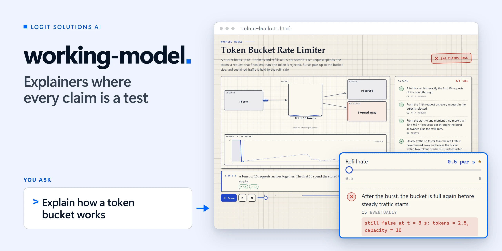
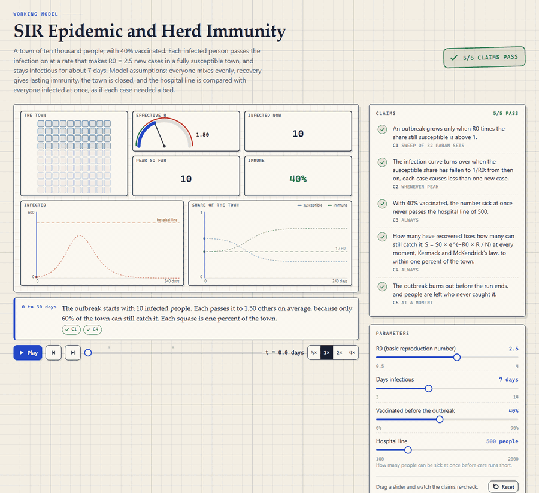

<h1 align="center">working-model</h1>

<p align="center"><b>Ask Claude Code how anything works; get a playable explainer where every claim is tested.</b></p>

<p align="center">
  <a href="LICENSE"></a>
  <a href="SKILL.md"></a>
  <a href="SKILL.md"></a>
</p>

<p align="center">
  <a href="#install">Install</a> · <a href="#before-and-after">Before And After</a> · <a href="#how-it-works">How It Works</a> · <a href="#proof">Proof</a> · <a href="#limits">Limits</a>
</p>

<p align="center">
  <picture>
    <source media="(prefers-color-scheme: dark)" srcset="docs/media/hero-dark.webp">
    <source media="(prefers-color-scheme: light)" srcset="docs/media/hero-light.webp">
    
  </picture>
</p>

working-model is a Claude Code skill and a small command-line tool. Because it is a plain agent skill (a `SKILL.md` folder), it also runs in Codex, Cursor and other agents. Ask how something works and the agent writes a short spec of the system with **claims** about how it behaves, simulates it, fails if any claim is false, and builds one offline HTML page that animates the model and re-checks every claim as the reader drags a slider.

## Install

```
/plugin marketplace add logitsolutionsai/working-model
/plugin install working-model@working-model
```

Then ask, for example: *"Explain how exponential backoff with jitter works."* Or paste this into Claude Code:

```
Clone https://github.com/logitsolutionsai/working-model into ~/.claude/skills/working-model, then explain how a token bucket works.
```

### Plain Skill Install

The skill is the repository itself (it has `SKILL.md` at its root). Clone it into your skills folder:

```bash
git clone https://github.com/logitsolutionsai/working-model ~/.claude/skills/working-model
```

On Windows, the folder is `%USERPROFILE%\.claude\skills\working-model`. Nothing needs installing: the tool runs on Node 20 or newer with no dependencies. For Codex, Cursor and other agents, see [Works With](#works-with).

### Command Line

```bash
git clone https://github.com/logitsolutionsai/working-model
cd working-model
node scripts/working-model.mjs check examples/                 # every example, every claim
node scripts/working-model.mjs build examples/lru-cache.model.json -o lru.html
node scripts/working-model.mjs new my-model --dir ./models      # a spec that passes, to edit
```

Other commands: `check --mutate` (mutation testing for the claims), `gallery`, `layout` (checks the page at desktop and phone sizes), `snap` and `gif`. Every command and flag: [docs/REFERENCE.md](docs/REFERENCE.md#commands).

## Before And After

You ask: *"Explain how a token bucket rate limiter works."* A claim the model does not back up fails before anyone sees it.

| Step | What the agent does | What you get |
| --- | --- | --- |
| 1 | Writes `token-bucket.model.json`: a bucket of `capacity` tokens refilling at `refill` per second, a burst of requests at t = 1 s, then steady traffic, and six claims | A plain JSON spec you can read and edit |
| 2 | Runs `working-model check` | `6/6 claims pass`, and the slider values that break each claim |
| 3 | Runs `check --mutate`, which breaks the rules on purpose in dozens of small ways (a `<` for a `<=`, a stack for a queue, a deleted line) | Which claims notice, which never fail, and which bugs no claim would catch |
| 4 | Runs `build` and `layout` | One offline `token-bucket.html`, checked at desktop and phone sizes |

The check in step 2 prints:

```
$ working-model check token-bucket.model.json
token-bucket.model.json - Token Bucket Rate Limiter
  9 parts, 4 params, 161 ticks, 12 ms

  PASS  burst-passes            A full bucket lets exactly the first 10 requests of the burst through.
  PASS  excess-rejected         From the 11th request on, every request in the burst is rejected.
  PASS  never-beyond-envelope   From the start to any moment t, no more than 10 + 2 × t requests get through: the burst allowance plus the refill rate.
  PASS  slow-traffic-passes     Steady traffic no faster than the refill rate is never turned away and leaves the bucket within two tokens of where it started; faster traffic drains it. This needs a bucket big enough to absorb uneven arrival times.
  PASS  refills-before-traffic  After the burst, the bucket is full again before steady traffic starts.
  PASS  holds-to-refill-rate    Once traffic outpaces the refill rate long enough to drain the bucket, requests pass at the refill rate, 2 per second.

  Sliders that break a claim:
    capacity = 1 breaks slow-traffic-passes
    capacity = 30 breaks burst-passes, excess-rejected, refills-before-traffic, holds-to-refill-rate
    refill = 0.5 breaks refills-before-traffic
    refill = 8 breaks holds-to-refill-rate
    burst = 1 breaks burst-passes, excess-rejected
    rate = 0.5 breaks holds-to-refill-rate

  6/6 claims pass
```

Every claim catches some broken version of the rules, and each surviving mutant is a question for the agent: add a claim, or explain why the change cannot be seen. The full walkthrough, with the claim JSON and the mutation report, is in [docs/REFERENCE.md](docs/REFERENCE.md#a-full-walkthrough).

## See It Work



*The SIR epidemic example. At 40% vaccinated, every claim passes. Drag vaccination down to 15% and the curve climbs past the hospital line: the claim "the number sick at once never passes the hospital line" turns red and shows the first moment it fails. The page computed that, not a script that recorded it.*


*The token bucket page, offline. Press play, scrub through time, step tick by tick with the arrow keys, and drag any slider. Every claim re-checks on the spot. Push the burst below the bucket size and "the first 10 requests pass" turns red, because there were never 10 requests: that is where the explanation stops holding.*

## How It Works

The agent writes a spec in plain JSON, with a JSON Schema for editor completion:

- **Params** become sliders (or buttons, with `choices`).
- **State** holds numbers, true/false, text and lists. **Rules** are written in a small, safe rule language with `if`, `while`, `for`, `let`, lists and 38 built-in functions, and no access to anything outside the model.
- **Events** are the scenario: one-off, bursts, periodic, or random arrivals from a seeded generator.
- **Parts**: box, tank, queue, stack, grid, counter, gauge, lamp, multi-state node, link with animated particles, chart, label and group, placed on a grid.
- **Narration** captions show live values through `{expression}` holes and cite the claims they rely on.
- **Claims** say how the model behaves, in one of seven kinds:

| Kind | Says | Example |
| --- | --- | --- |
| `at` | true at a moment | "The first {capacity} requests of the burst pass." |
| `always` | true at every tick | "No more than the bucket size plus the refill rate times t ever gets through." |
| `never` | false at every tick | "An added item is never reported missing." |
| `eventually` | true by a deadline | "Every client gets through within four seconds of the server coming back." |
| `whenever` | true after every occurrence of an event, or within a time of it | "After the service recovers, the breaker closes within one cooldown period." |
| `sweep` | true for many sampled param sets; with `holdsWhen`, true inside a condition and false outside it | "An outbreak grows only when R0 times the share still susceptible is above 1." |
| `compare` | a measure of one run against another | "Full jitter lowers the peak retry load compared with no jitter." |

A failing claim reports its first counterexample: the time, the values involved, and the params, such as `fails at t = 26 days: I = 502.61, beds = 500`.

What keeps the page honest:

- **One engine.** `check` runs the simulator, claim checker and lint in Node, and `build` inlines the very same modules into the page; tests compare the two claim by claim.
- **Claims are tests, and the claims are tested too.** `build` refuses to build while a claim fails, and the skill tells the agent never to weaken or delete a claim to make it pass. `check --mutate` compiles small deliberate bugs into the rules and reports every claim that never fails and every bug no claim catches.
- **Numbers in text are bound.** Lint flags any number typed into a caption or claim instead of bound to the model, so the text stays true when a slider moves.
- **Deterministic, safe and offline.** Seeded 32-bit random draws give the same run in Node and Chromium browsers; the rule language has no `eval`, no globals and bounded work; the page's Content Security Policy blocks every network request.

The full spec example and every honesty mechanism in detail: [docs/REFERENCE.md](docs/REFERENCE.md). Field reference: [references/spec.md](references/spec.md), [references/parts.md](references/parts.md), [references/claims.md](references/claims.md), [references/walkthrough.md](references/walkthrough.md) and [schema/model.schema.json](schema/model.schema.json).

## Proof

Eleven examples, each with at least one claim a reader can break with a slider. Open [gallery/index.html](gallery/index.html) after cloning. The mutation score is the share of deliberate bugs in the rules that some claim catches, from `check --mutate`; a test keeps these numbers equal to what the command prints.

| Example | What it shows | A slider that breaks a claim | Claims |
| --- | --- | --- | --- |
| [Token bucket rate limiter](examples/token-bucket.model.json) | Bursts pass up to the bucket size; sustained traffic is held to the refill rate. | Burst size below the bucket size | 6/6 claims, mutation score 94% |
| [Exponential backoff with and without jitter](examples/backoff-jitter.model.json) | Synchronized retries keep colliding; jitter spreads them out. | Jitter to zero | 5/5 claims, mutation score 62% |
| [LRU cache](examples/lru-cache.model.json) | The cache always holds the most recently used keys; a loop one key larger than the cache gets no hits; a one-time scan flushes the hot keys. | Hot keys above the slot count | 6/6 claims, mutation score 100% |
| [TCP AIMD](examples/tcp-aimd.model.json) | Additive increase and multiplicative decrease make two flows converge to a fair share. | Decrease factor to one | 3/3 claims, mutation score 82% |
| [Circuit breaker](examples/circuit-breaker.model.json) | Scattered failures never trip the breaker; it spares a failing service and tests it before closing again. | Cooldown to its minimum | 5/5 claims, mutation score 92% |
| [SIR epidemic](examples/sir-epidemic.model.json) | Growth only when R0 times the susceptible share is above one; the peak comes at the herd immunity threshold. | Vaccination down | 5/5 claims, mutation score 86% |
| [Round robin vs least connections](examples/load-balancing.model.json) | Least connections keeps queues short when one server is slow; each server serves its jobs first come, first served. | Policy to round robin | 6/6 claims, mutation score 92% |
| [Compound vs simple interest](examples/compound-interest.model.json) | Compounding pays interest on interest; the rule of 72. | Payments per year above one | 5/5 claims, mutation score 94% |
| [Bloom filter](examples/bloom-filter.model.json) | No false negatives; false positives follow the share of bits set. | Items added up | 4/4 claims, mutation score 76% |
| [Raft leader election](examples/raft-election.model.json) | Random election timeouts give one leader per term and replace a crashed leader quickly. | Timeout randomness to zero, or heartbeats slower than the shortest timeout | 5/5 claims, mutation score 70% |
| [Inventory reorder point](examples/reorder-point.model.json) | No sale is lost exactly when the reorder point covers the demand over the lead time, whatever the order size. | Lead time up | 3/3 claims, mutation score 92% |

Below 100%, `check --mutate` names each deliberate bug that no claim of that example catches, by rule and location.

## Limits

- **Discrete time.** Models advance in fixed ticks. Continuous systems are approximated (the SIR example uses a small step), and a claim that is exact in continuous time may be off by a tick.
- **Not a physics engine.** There is no geometry, collision or continuous mechanics. The sweet spot is behaviour: algorithms, protocols, queues, feedback loops, economics, epidemiology.
- **The claims are only as good as the model.** A passing claim says the model behaves that way. Whether the model matches the real system is a judgement the sources, the stated assumptions and the reader have to back up.
- **Small models.** Up to 100000 ticks and ten million stored values per run, two million rule steps per simulation (copying or scanning a list costs a step per item), and 200 million steps for one check of every claim, sweeps and compares included. Sweeps re-run the model for each sample, so large models make slider dragging slow.
- **Claims are only as good as their expressions.** A claim that reads back one of its own rules (a `min` cap, a guard) passes but proves nothing; `check --mutate` finds most such claims, but a mutation score only counts the bugs it tried, one small change at a time. Captions and part bindings are not tested, only the claims they cite, unless a counter, gauge or tank is given an `expect`: an independent expression `check` compares it with at every tick.
- **Layout is on a grid.** Parts sit on an explicit grid. Text keeps a readable size on phones, which means a crowded grid may need wider parts or shorter labels; `layout` points these out.
- **Browsers.** Runs are identical in Node and Chromium browsers. Other browsers may round `exp`, `log`, `pow`, `sin` and `cos` differently in the last digit, which can change a random arrival or a claim that sits exactly on its threshold.

## Works With

- **Claude Code**: install the plugin, or clone the repository into `~/.claude/skills/working-model` (see [Install](#install)).
- **Codex, Cursor and other agents**: any agent that reads `SKILL.md` skills can use it. Clone the repository into the folder your agent loads skills from, for example `~/.agents/skills/working-model` (read by recent Codex and Cursor versions), `~/.codex/skills/working-model` (Codex) or `~/.cursor/skills/working-model` (Cursor).
- **Agents without skill support**: add a line to the agent's instructions file (such as `AGENTS.md`) that points it at `SKILL.md` in this folder.
- **Runtime**: Node 20 or newer for `check` and `build`; Node 22 or newer for `layout`, `snap` and `gif`, which drive a locally installed Chrome, Edge or Chromium (set `WORKING_MODEL_CHROME` to pick one). Nothing is downloaded. `gif` also needs `ffmpeg`.

## FAQ

**Does the page need a server or an internet connection?**
No. It is one HTML file with everything inlined, and its security policy blocks all network requests.

**Can I edit the spec by hand?**
Yes. It is plain JSON with a JSON Schema for editor completion. Run `check` after each change.

**What does "N/N claims pass" in the page mean?**
The page simulated the model with the current slider values and checked every claim in your browser, just now. Move a slider and it runs again.

**Why did a claim fail when I moved a slider?**
Every claim is true within some range of conditions. The failing claim shows the first moment it breaks; that boundary is part of the explanation.

**Which Node version is needed?**
Node 20 or newer for `check` and `build`; Node 22 or newer for `layout`, `snap` and `gif`, which use the built-in WebSocket client.

**How do I add my own part type or example?**
See [CONTRIBUTING.md](CONTRIBUTING.md) and [docs/ARCHITECTURE.md](docs/ARCHITECTURE.md).

## Contributing

New examples and part types are welcome. The bar for an example is that its claims hold for the real mechanism and are backed by a source: see [CONTRIBUTING.md](CONTRIBUTING.md) for the requirements and [docs/ARCHITECTURE.md](docs/ARCHITECTURE.md) for how the code fits together.

```bash
npm install          # dev dependency only: playwright-core, for the browser tests
npm test             # unit tests: rule language, simulation, claims, lint, schema, examples, CLI
npm run test:e2e     # browser tests against your local Chrome, with all network requests aborted
```

## License

MIT. Copyright Logit Solutions AI. See [LICENSE](LICENSE).

Repository: https://github.com/logitsolutionsai/working-model
