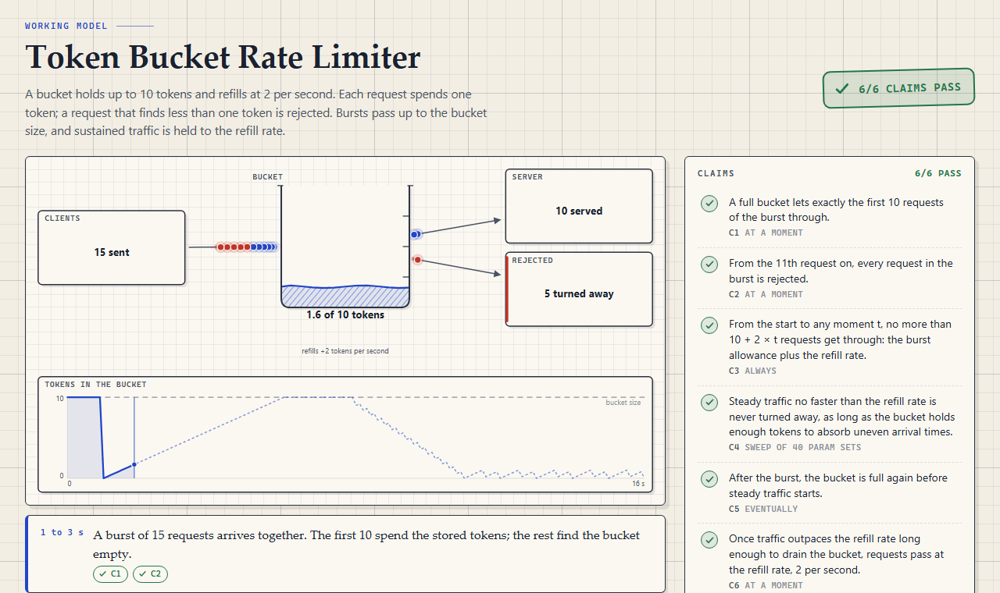

# Working Model

**Ask how anything works. Get a working model: an animated explainer you can play with, where every claim is a passing test.**


*The SIR epidemic example. At 40% vaccinated, every claim passes. Drag vaccination down to 15% and the curve climbs past the hospital line: the claim "the number sick at once never passes the hospital line" turns red and shows the first moment it fails. The page computed that, not a script that recorded it.*

Working Model is an agent skill and a small command-line tool. Ask your agent "explain how a token bucket rate limiter works" and it writes a short spec: sliders, state, rules, a scenario, visual parts and, most importantly, **claims** such as "the 11th request in the burst is rejected" or "traffic no faster than the refill rate is never turned away". The tool simulates the spec, fails if any claim is false, and builds one offline HTML page that animates the model and re-checks every claim as the reader drags a slider.

A claim the model does not back up fails before anyone sees it. What is tested is the claim's expression, and a claim that cannot fail passes as easily as a true one, so the claims are tested too: `check --mutate` breaks the rules on purpose in dozens of small ways (a `<` for a `<=`, a stack for a queue, a deleted line) and reports which claims notice, which never fail, and which bugs no claim would catch.

## A 30-Second Walkthrough

You ask: *"Explain how a token bucket rate limiter works."*

1. The agent writes `token-bucket.model.json`: a bucket of `capacity` tokens refilling at `refill` per second, a burst of requests at t = 1 s, then steady traffic, and six claims. One of them:

   ```json
   { "id": "excess-rejected", "kind": "at", "t": 1, "expr": "rejected == burst - capacity",
     "text": "From the {capacity + 1:ord} request on, every request in the burst is rejected." }
   ```

2. It runs the check:

   ```
   $ working-model check token-bucket.model.json
   token-bucket.model.json - Token Bucket Rate Limiter
     9 parts, 4 params, 161 ticks, 12 ms

     PASS  burst-passes            A full bucket lets exactly the first 10 requests of the burst through.
     PASS  excess-rejected         From the 11th request on, every request in the burst is rejected.
     PASS  never-beyond-envelope   From the start to any moment t, no more than 10 + 2 × t requests get through: the burst allowance plus the refill rate.
     PASS  slow-traffic-passes     Steady traffic no faster than the refill rate is never turned away and leaves the bucket within two tokens of where it started; faster traffic drains it. This needs a bucket big enough to absorb uneven arrival times.
     PASS  refills-before-traffic  After the burst, the bucket is full again before steady traffic starts.
     PASS  holds-to-refill-rate    Once traffic outpaces the refill rate long enough to drain the bucket, requests pass at the refill rate, 2 per second.

     Sliders that break a claim:
       capacity = 1 breaks slow-traffic-passes
       capacity = 30 breaks burst-passes, excess-rejected, refills-before-traffic, holds-to-refill-rate
       refill = 0.5 breaks refills-before-traffic
       refill = 8 breaks holds-to-refill-rate
       burst = 1 breaks burst-passes, excess-rejected
       rate = 0.5 breaks holds-to-refill-rate

     6/6 claims pass
   ```

3. It tests the claims by breaking the rules on purpose:

   ```
   $ working-model check token-bucket.model.json --mutate
     ...
     excess-rejected         18 kills
                             e.g. M8 rules.on.request:1:1  if tokens >= 1 { … } else { … } → if tokens >= 1 { … }
     ...
     Survived mutants (the rules could break this way and no claim would notice):
       rules.on.request
         M23   rules.on.request:4:8 t > 12 → t >= 12  [relational]
     ...
   ```

   Every claim catches some broken version of the rules, and each surviving mutant is a question for the agent: add a claim, or explain why the change cannot be seen.

4. It builds the page and checks the layout at desktop and phone sizes:

   ```
   $ working-model build token-bucket.model.json -o token-bucket.html
   $ working-model layout token-bucket.model.json
   ```

5. You open `token-bucket.html`, offline, and get this:



Press play, scrub through time, step tick by tick with the arrow keys, and drag any slider. Every claim re-checks on the spot. Push the burst below the bucket size and "the first 10 requests pass" turns red, because there were never 10 requests: that is where the explanation stops holding.

## Quick Start

### Claude Code Plugin

```
/plugin marketplace add logitsolutionsai/working-model
/plugin install working-model@working-model
```

Then ask: *"Explain how exponential backoff with jitter works."*

### Plain Skill Install

The skill is the repository itself (it has `SKILL.md` at its root). Clone it into your skills folder:

```bash
git clone https://github.com/logitsolutionsai/working-model ~/.claude/skills/working-model
```

On Windows, the folder is `%USERPROFILE%\.claude\skills\working-model`. Nothing needs installing: the tool runs on Node 20 or newer with no dependencies.

### Codex, Cursor and Other Agents

Any agent that reads `SKILL.md` skills can use it. Clone the repository into the folder your agent loads skills from, for example `~/.agents/skills/working-model` (read by recent Codex and Cursor versions), `~/.codex/skills/working-model` (Codex) or `~/.cursor/skills/working-model` (Cursor). For an agent without skill support, add a line to its instructions file (such as `AGENTS.md`) that points it at `SKILL.md` in this folder.

### Command Line

```bash
git clone https://github.com/logitsolutionsai/working-model
cd working-model
node scripts/working-model.mjs check examples/                 # every example, every claim
node scripts/working-model.mjs build examples/lru-cache.model.json -o lru.html
node scripts/working-model.mjs new my-model --dir ./models      # a spec that passes, to edit
```

| Command | What it does |
| --- | --- |
| `check <spec or folder>` | Schema, compile, simulate, claims, lint. Prints `N/N claims pass` or each failure with its counterexample. `--json`, `--strict`, `--set name=value`. Exit 0 pass, 1 failing claim or lint error, 2 invalid spec. |
| `check --mutate` | Mutation testing for the claims: per claim the mutants it kills, the claims that never fail, the mutants no claim catches, and a score. `--mutate=N` caps the mutants (default 200, seeded sample above that); `--mutate-strict` with `--min-score 80` exits 1 on a weak result. |
| `build <spec> -o page.html` | One standalone page, no network requests. Refuses to build while a claim fails, unless `--force`. `--mutate` stores the mutation score in the page. |
| `new <name>` | Scaffolds a small spec that passes `check` and `layout`. |
| `gallery` | Builds every example, with its mutation score, and `gallery/index.html`. `--thumbs` adds screenshots. |
| `layout <spec>` | Opens the page in headless Chrome at 1280 by 800 and 390 by 844, and fails on overlapping parts, clipped or colliding text, or sideways scrolling. Writes screenshots. |
| `snap <spec> --at <t> -o shot.png` | A screenshot at a moment, optionally with `--set` slider values. |
| `gif <spec> -o anim.gif` | An animated GIF via ffmpeg, optionally dragging a slider (`--drag vaccinated=0.4..0.15@6..8`). |

`layout`, `snap` and `gif` drive a locally installed Chrome, Edge or Chromium over the DevTools protocol (set `WORKING_MODEL_CHROME` to pick one). Nothing is downloaded. `gif` also needs `ffmpeg`.

## The Spec at a Glance

```json
{
  "title": "Token Bucket Rate Limiter",
  "summary": "A bucket holds up to {capacity} tokens and refills at {refill} per second.",
  "sources": [{ "title": "RFC 2697", "url": "https://www.rfc-editor.org/rfc/rfc2697" }],
  "dt": 0.1, "duration": 16, "seed": 7,
  "params": [{ "id": "capacity", "label": "Bucket size", "min": 1, "max": 30, "step": 1, "default": 10 }],
  "events": [{ "name": "request", "at": 1, "count": "burst" }],
  "state": { "tokens": "capacity", "accepted": 0, "rejected": 0 },
  "rules": {
    "tick": "tokens = min(capacity, tokens + refill * dt)",
    "on": { "request": "if tokens >= 1 { tokens -= 1; accepted += 1; emit('accept') } else { rejected += 1; emit('reject') }" }
  },
  "parts": [{ "id": "bucket", "type": "tank", "at": [4, 0, 4, 4], "level": "tokens / capacity", "text": "{tokens:.1} of {capacity}" }],
  "narration": [{ "from": 1, "to": 3, "text": "The first {capacity} requests spend the stored tokens.", "cites": ["burst-passes"] }],
  "claims": [{ "id": "burst-passes", "kind": "at", "t": 1, "expr": "accepted == capacity", "text": "A full bucket lets the first {capacity} requests through." }]
}
```

- **Params** become sliders (or buttons, with `choices`).
- **State** holds numbers, true/false, text and lists. **Rules** are written in a small, safe rule language with `if`, `while`, `for`, `let`, lists and 38 built-in functions, and no access to anything outside the model.
- **Events** are the scenario: one-off, bursts, periodic, or random arrivals from a seeded generator.
- **Parts**: box, tank, queue, stack, grid, counter, gauge, lamp, multi-state node, link with animated particles, chart, label and group, placed on a grid.
- **Narration** captions show live values through `{expression}` holes and cite the claims they rely on.

Full reference: [references/spec.md](references/spec.md), [references/parts.md](references/parts.md), [references/claims.md](references/claims.md), and a worked example in [references/walkthrough.md](references/walkthrough.md). JSON Schema: [schema/model.schema.json](schema/model.schema.json).

## Claim Kinds

| Kind | Says | Example |
| --- | --- | --- |
| `at` | true at a moment | "The first {capacity} requests of the burst pass." |
| `always` | true at every tick | "No more than the bucket size plus the refill rate times t ever gets through." |
| `never` | false at every tick | "An added item is never reported missing." |
| `eventually` | true by a deadline | "Every client gets through within four seconds of the server coming back." |
| `whenever` | true after every occurrence of an event, or within a time of it | "After the service recovers, the breaker closes within one cooldown period." |
| `sweep` | true for many sampled param sets; with `holdsWhen`, true inside a condition and false outside it | "An outbreak grows only when R0 times the share still susceptible is above 1." |
| `compare` | a measure of one run against another | "Full jitter lowers the peak retry load compared with no jitter." |

A failing claim reports its first counterexample: the time, the values involved, and the params, such as `fails at t = 26 days: I = 502.61, beds = 500`.

## The Gallery

Eleven examples, each with at least one claim a reader can break with a slider. Open [gallery/index.html](gallery/index.html) after cloning. The mutation score is the share of deliberate bugs in the rules that some claim catches, from `check --mutate`; a test keeps these numbers equal to what the command prints.

| Example | What it shows | A slider that breaks a claim | Claims |
| --- | --- | --- | --- |
| [Token bucket rate limiter](examples/token-bucket.model.json) | Bursts pass up to the bucket size; sustained traffic is held to the refill rate. | Burst size below the bucket size | 6/6 claims, mutation score 94% |
| [Exponential backoff with and without jitter](examples/backoff-jitter.model.json) | Synchronized retries keep colliding; jitter spreads them out. | Jitter to zero | 5/5 claims, mutation score 62% |
| [LRU cache](examples/lru-cache.model.json) | The cache always holds the most recently used keys; a loop one key larger than the cache gets no hits; a one-time scan flushes the hot keys. | Hot keys above the slot count | 6/6 claims, mutation score 100% |
| [TCP AIMD](examples/tcp-aimd.model.json) | Additive increase and multiplicative decrease make two flows converge to a fair share. | Decrease factor to one | 3/3 claims, mutation score 82% |
| [Circuit breaker](examples/circuit-breaker.model.json) | Scattered failures never trip the breaker; it spares a failing service and tests it before closing again. | Cooldown to its minimum | 5/5 claims, mutation score 92% |
| [SIR epidemic](examples/sir-epidemic.model.json) | Growth only when R0 times the susceptible share is above one; the peak comes at the herd immunity threshold. | Vaccination down | 5/5 claims, mutation score 86% |
| [Round robin vs least connections](examples/load-balancing.model.json) | Least connections keeps queues short when one server is slow; each server serves its jobs first come, first served. | Policy to round robin | 6/6 claims, mutation score 92% |
| [Compound vs simple interest](examples/compound-interest.model.json) | Compounding pays interest on interest; the rule of 72. | Payments per year above one | 5/5 claims, mutation score 94% |
| [Bloom filter](examples/bloom-filter.model.json) | No false negatives; false positives follow the share of bits set. | Items added up | 4/4 claims, mutation score 76% |
| [Raft leader election](examples/raft-election.model.json) | Random election timeouts give one leader per term and replace a crashed leader quickly. | Timeout randomness to zero, or heartbeats slower than the shortest timeout | 5/5 claims, mutation score 70% |
| [Inventory reorder point](examples/reorder-point.model.json) | No sale is lost exactly when the reorder point covers the demand over the lead time, whatever the order size. | Lead time up | 3/3 claims, mutation score 92% |

## How It Stays Honest

- **One engine.** The simulator, claim checker and lint are plain JavaScript modules with no dependencies. `check` runs them in Node, and `build` inlines the very same modules into the page. A test evaluates the inlined copy and the modules side by side on every example, and the browser tests compare the page's claim results with Node's, claim by claim.
- **Claims are tests.** `check` exits non-zero when a claim fails, and `build` refuses to build until it passes. The skill tells the agent never to weaken or delete a claim to make it pass, and to say whether the model or the claim was wrong.
- **The claims are tested too.** `check --mutate` compiles small deliberate bugs into the parsed rules and re-checks every claim against each one. A claim that never fails, or a bug no claim catches, is reported by name and location; the skill tells the agent to answer each one with a stronger claim, a better scenario or a stated reason.
- **Numbers in text are bound.** Lint flags any number typed into a caption or claim text instead of bound to the model, and suggests the binding (`{capacity}`, `{capacity + 1:ord}`), so the text stays true when a slider moves. A caption that cites a failing claim is an error.
- **Deterministic.** Random draws come from a seeded generator that uses only 32-bit integer maths, so the same spec gives the same run in Node and in Chrome, Edge and other Chromium browsers. Other browsers may round `exp`, `log`, `pow`, `sin` and `cos` differently in the last digit, which can change a random arrival or a claim that sits exactly on its threshold.
- **Safe rules.** The rule language is parsed and interpreted by hand-written code: no `eval`, no `Function`, no member access, no globals. Steps, list work, list and value sizes, nesting, event firings, the stored trace and the total work of one claim check are all bounded, so a spec from a stranger fails with an error code instead of hanging or running out of memory.
- **Offline pages.** A strict Content Security Policy (`default-src 'none'`) means a built page cannot load anything from the network, and it allows only the page's own two scripts, by hash. Spec text (titles, labels, captions, claims, values) is always inserted as text, never as HTML.

## Limitations

- **Discrete time.** Models advance in fixed ticks. Continuous systems are approximated (the SIR example uses a small step), and a claim that is exact in continuous time may be off by a tick.
- **Not a physics engine.** There is no geometry, collision or continuous mechanics. The sweet spot is behaviour: algorithms, protocols, queues, feedback loops, economics, epidemiology.
- **The claims are only as good as the model.** A passing claim says the model behaves that way. Whether the model matches the real system is a judgement the sources, the stated assumptions and the reader have to back up.
- **Small models.** Up to 100000 ticks and ten million stored values per run, two million rule steps per simulation (copying or scanning a list costs a step per item), and 200 million steps for one check of every claim, sweeps and compares included. Sweeps re-run the model for each sample, so large models make slider dragging slow.
- **Claims are only as good as their expressions.** A claim that reads back one of its own rules (a `min` cap, a guard) passes but proves nothing; `check --mutate` finds most such claims, but a mutation score only counts the bugs it tried, one small change at a time. Captions and part bindings are not tested, only the claims they cite, unless a counter, gauge or tank is given an `expect`: an independent expression `check` compares it with at every tick.
- **Layout is on a grid.** Parts sit on an explicit grid. Text keeps a readable size on phones, which means a crowded grid may need wider parts or shorter labels; `layout` points these out.

## FAQ

**Does the page need a server or an internet connection?**
No. It is one HTML file with everything inlined, and its security policy blocks all network requests.

**Can I edit the spec by hand?**
Yes. It is plain JSON with a JSON Schema for editor completion. Run `check` after each change.

**What does "N/N claims pass" in the page mean?**
The page simulated the model with the current slider values and checked every claim in your browser, just now. Move a slider and it runs again.

**Why did a claim fail when I moved a slider?**
Every claim is true within some range of conditions. The failing claim shows the first moment it breaks; that boundary is part of the explanation.

**Which Node version is needed?**
Node 20 or newer for `check` and `build`; Node 22 or newer for `layout`, `snap` and `gif`, which use the built-in WebSocket client.

**How do I add my own part type or example?**
See [CONTRIBUTING.md](CONTRIBUTING.md) and [docs/ARCHITECTURE.md](docs/ARCHITECTURE.md).

## Development

```bash
npm install          # dev dependency only: playwright-core, for the browser tests
npm test             # unit tests: rule language, simulation, claims, lint, schema, examples, CLI
npm run test:e2e     # browser tests against your local Chrome, with all network requests aborted
```

## Licence

MIT. Copyright Logit Solutions AI. See [LICENSE](LICENSE).

Repository: https://github.com/logitsolutionsai/working-model
